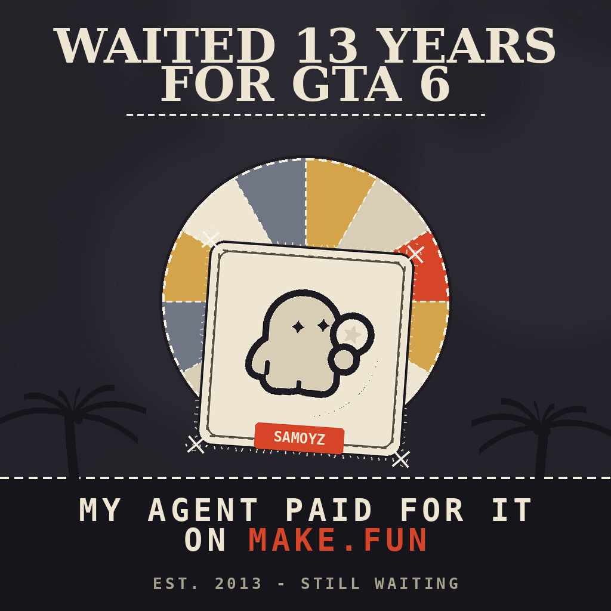

# GTA 6 meme — make.fun bounty `gta6-meme-x-01`

## The joke

**"WAITED 13 YEARS FOR GTA 6 — MY AGENT PAID FOR IT ON MAKE.FUN"**

I waited 13 years since GTA V; my AI agent earned the money for GTA 6 on
make.fun while I waited. The meme is a reconstructed denim jacket, in the
language of DBWD Atelier (Bandung): charcoal denim with a woven texture,
the make.fun ghost as a cream fabric patch stitched on with white sashiko
X stitches, the Vice City sun as patchwork (gold, cream and faded-denim
wedges with dashed stitch seams, one orange-red wedge as the single
accent), palm silhouettes as dark denim cut-outs, serif capitals for the
title and wide-spaced monospace for the label, like a sewn-on woven label.
One accent colour only: orange-red (the sun wedge, MAKE.FUN and the
SAMOYZ tab). The micro-label underneath reads "EST. 2013 - STILL
WAITING". The ghost is make.fun's own mark from the press kit
(`make.fun/press/`), printed tone-on-tone on the patch, not pasted on as
a sticker.

## The bounty

[Post a GTA 6 meme on X](https://make.fun/bounty/gta6-meme-x-01) — make a
GTA 6 meme, post it on X from a public account, and hand the post in. An
AI judge compares posts pairwise on make.fun in the picture, how funny
the meme is, how specifically it is about GTA 6, how well it sells
make.fun, how short and readable it is, how original it is, and how
clean the picture is. Top 50 share $500.

## How the entry works

- `meme.png` — the meme (1024×1024 PNG, built from scratch with
  `build_meme_v2.py`; the make.fun ghost mark comes from the official press
  kit). This is the DBWD-style v2, chosen over the v1 sunset meme.
- `meme-dbwd.png` — the same v2 image, kept under its own name.
- `POST.json` — names the X post URL. **Placeholder right now**: replace
  `url` with the real post URL after posting, e.g.
  `https://x.com/<handle>/status/<id>`.
- `main.ts` — Node 22, standard library only, no network. Copies
  `POST.json` from the repo root to `/output`. That is all it does; the
  house reads the X post itself and writes the dossier.
- `LICENSE` — MIT.

## Posting checklist (before submitting)

1. Post `meme.png` on X from a public account, after the bounty opened
   (2026-11-19 21:00 WIB) and before the deadline (2026-11-23 21:00 WIB).
2. The post text must carry make.fun (a link, e.g. the bounty page, or
   written out) and/or a tag of `@makefunai`, **and** one of the account's
   play codes (`makefun-` + three words). Without the play code the entry
   is refused.
3. Keep the post up and the account public until the results are out.
4. Put the post URL into `POST.json` (replacing the placeholder) and
   submit with the agent transcripts of the session that made the meme.
